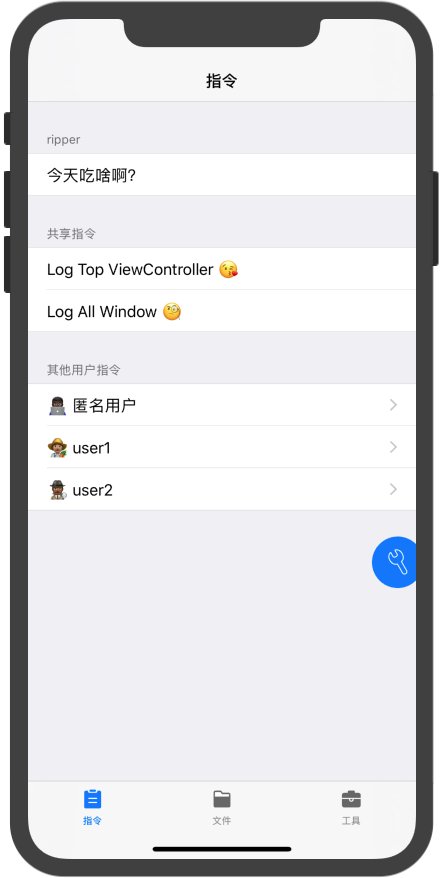
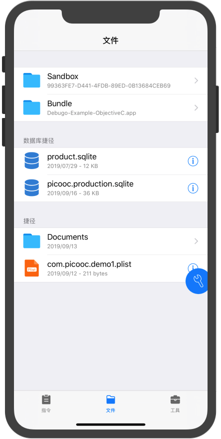
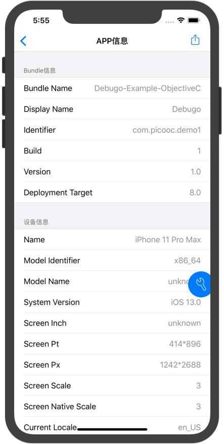
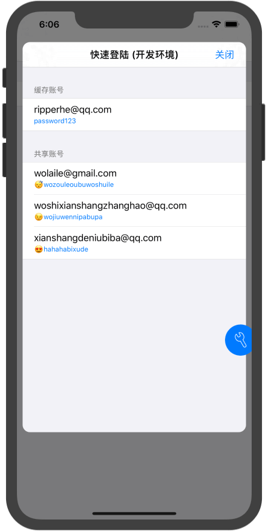
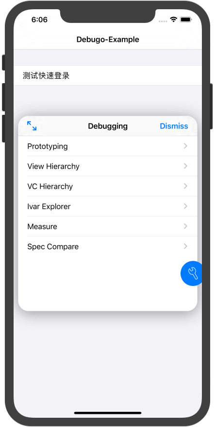
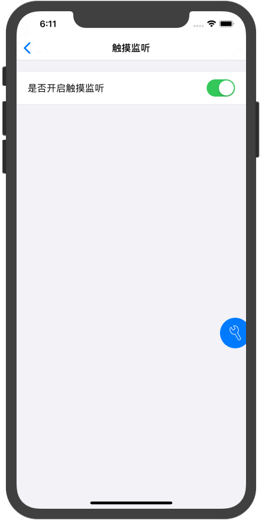
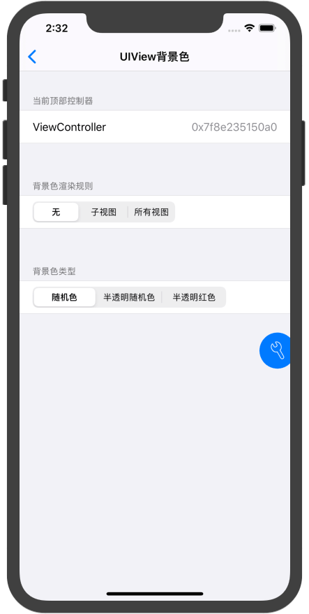
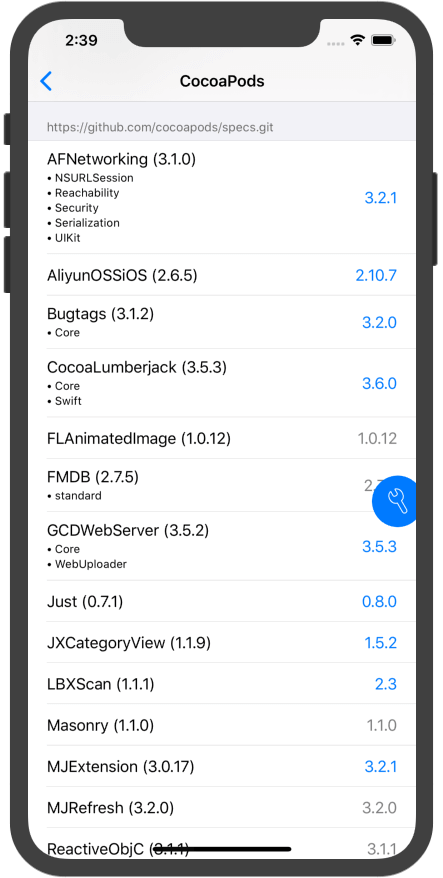
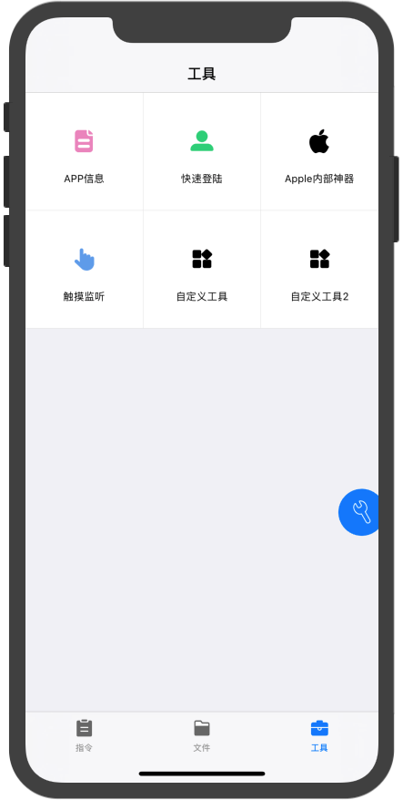

<p align="center">
  
</p>

# Debugo

[](https://cocoapods.org/pods/Debugo)
[](https://cocoapods.org/pods/Debugo)
[](https://cocoapods.org/pods/Debugo)

Debugo 是一款使用 Objective-C 编写的 iOS 应用内调试工具。通过悬浮球打开调试面板，集中查看文件、网络请求、业务日志和 App 信息，也可以添加项目专用的指令与工具。

- [x] **方便** 一行代码即可启用
- [x] **可配置** 支持工具 Tab、自定义悬浮球长按事件和业务回调
- [x] **灵活** 可添加自定义指令和工具

## Features

* 指令
	* 快捷添加代码块，点击指令列表的 `Cell` 执行
	* 支持多人协作，根据 User 自动优先显示当前用户的指令
* 文件
	* 支持查看沙盒和 Bundle 的文件
	* 支持预览数据库及其他大部分文件
	* 支持利用 `AirDrop` 分享文件
	* 支持设置文件捷径，快速直达经常查看的文件
* App 信息
	* 查看 Bundle 信息
	* 查看设备信息
	* 查看编译信息（[需配置脚本 🚀](https://github.com/ripperhe/Debugo/blob/master/docs/build-info.md)）
* AFNetworking 请求
	* 监听显式传入的 `AFURLSessionManager`，查看请求地址、请求头、请求体、响应及耗时
	* 支持配置列表展示模块，详情页保留完整模块
* Alamofire 请求
	* 监听显式传入的 `Alamofire.Session`，列表与 AFNetworking 插件独立，互不混入
	* Debugo 不把 Alamofire 作为硬依赖；将 `Debugo/Optional/Alamofire/DGAlamofireSessionHook.swift` 加入 App Target 后即可拦截
* Log 日志
	* 通过 `DGLogTypeModel` 接入业务日志，在独立悬浮窗口中查看
	* 支持筛选、调整窗口高度、自定义 Cell 和点击回调
* 快速登录
	* 简单配置之后，可一键登录
	* 调用一句代码即可缓存账号
* Apple 内部神器
	* 集成苹果内部工具 `UIDebuggingInformationOverlay`
	* [查看使用方法 🚀](http://ryanipete.com/blog/ios/swift/objective-c/uidebugginginformationoverlay/)
* 触摸监听
	* 监听手势触摸
	* 用于手机录屏时能够看到手指的操作
* UIView 背景色
	* 快速显示顶部控制器视图的背景色
	* 多种渲染方式
* CocoaPods
	* 查看工程安装的 pod 库（[需配置脚本 🚀](https://github.com/ripperhe/Debugo/blob/master/docs/build-info.md)）
	* 查看 pod 库的最新版本
* Swift Package Manager
	* 查看工程依赖的 Swift Package（同样依赖上方 Build Info 脚本，会拷贝 `Package.resolved`）
	* 对 GitHub 仓库尽力展示最新 Release / Tag 版本；非 GitHub 来源不查询

## Snapshot

以下截图展示部分内置工具。

<!--
-->

| 指令 | 文件 | APP 信息 |
|:---: |:---:| :---: |
|  |  | |

| 快速登录 | Apple 内部神器 | 触摸监听 |
|:---: |:---:| :---: |
|  |  | |

| UIView 背景色 | CocoaPods | 工具总览 |
|:---: |:---:| :---: |
|  |  | |

## 环境与依赖

- 仓库中的 [Debugo.podspec](Debugo.podspec) 版本为 `0.4.0`，最低支持 iOS 15.0，使用 ARC。
- 当前示例工程和 Podfile 的最低部署版本同样为 **iOS 15.0**；请使用支持 iOS 15 的 Xcode。
- podspec 声明的依赖为 **FMDB >= 2.7.2** 和 **AFNetworking >= 4.0.1**；示例工程另将 AFNetworking 约束为 `~> 4.0`。

## 接入流程

下面以业务工程 `YourApp` 为例，在 `Debug` 和内测配置 `ReleaseInhouse` 中启用 Debugo。

### 1. 准备构建配置

在 Xcode 的 Project → Info → Configurations 中确认存在 `Debug`、`Release` 和 `ReleaseInhouse`。如果没有内测配置，可以复制 `Release` 并命名为 `ReleaseInhouse`。下文名称必须与工程中的配置名称一致。

### 2. 配置 Podfile

使用已发布的指定版本：

```ruby
platform :ios, '15.0'

project 'YourApp',
        'Debug' => :debug,
        'Release' => :release,
        'ReleaseInhouse' => :release

target 'YourApp' do
  pod 'Debugo', '0.4.0',
      :configurations => ['Debug', 'ReleaseInhouse']
end

post_install do |installer|
  installer.pods_project.targets.each do |target|
    target.build_configurations.each do |config|
      # 与当前 Example 的部署版本保持一致
      config.build_settings['IPHONEOS_DEPLOYMENT_TARGET'] = '15.0'

      # 仅为 Debugo Pod 的 Debug 和 ReleaseInhouse 配置启用调试功能。
      # App 的宏不会传递给 Pod；配置名称需与工程一致，正式 Release 不在此处启用。
      if target.name == 'Debugo' && ['Debug', 'ReleaseInhouse'].include?(config.name)
        definitions = Array(config.build_settings['GCC_PREPROCESSOR_DEFINITIONS'])
        definitions << '$(inherited)' unless definitions.include?('$(inherited)')
        definitions << 'DebugoCanBeEnabled=1' unless definitions.include?('DebugoCanBeEnabled=1')
        config.build_settings['GCC_PREPROCESSOR_DEFINITIONS'] = definitions
      end
    end
  end
end
```

将 `YourApp` 替换为实际工程和 Target 名称。如果已经有 `post_install`，将上述逻辑合并到已有 block 中。

开发本仓库时，将上面的 `pod 'Debugo'` 声明替换为本地路径方式。本仓库 Example 的 Podfile 位于根目录下两级，所以使用：

```ruby
pod 'Debugo',
    :configurations => ['Debug', 'ReleaseInhouse'],
    :path => '../..'
```

`:path` 相对于 **Podfile 所在目录**，用于读取本地 `Debugo.podspec`，不需要再通过 Xcode 手动添加 Debugo 源文件或 Bundle。其他业务工程请按仓库的实际位置调整路径。已发布版本以对应版本源码为准；本仓库新增功能可通过本地 Pod 调试。

这里有两个独立设置：`:configurations` 决定哪些配置链接 Debugo；`post_install` 中的 `DebugoCanBeEnabled=1` 决定 Debugo 库内部是否编译启用代码。仅设置其中一个不足以完成内测配置的接入。

### 3. 配置 App 的编译宏

在业务 **App Target → Build Settings → Preprocessor Macros** 中按配置设置，保留 `$(inherited)` 和其他已有宏：

| 构建配置 | App 的 Preprocessor Macros | Debugo Pod 的宏 |
| --- | --- | --- |
| Debug | `$(inherited)`、`DebugoCanBeEnabled=1` | 由上述 `post_install` 设置为 `1` |
| ReleaseInhouse | `$(inherited)`、`DebugoCanBeEnabled=1` | 由上述 `post_install` 设置为 `1` |
| Release | `$(inherited)`、`DebugoCanBeEnabled=0` | 不额外启用，且不链接 Debugo |

App 和 Pod 是分别编译的，宏不会互相继承。App 的宏控制下文的导入、调用代码及 `DGLog` 等头文件宏；Pod 的宏控制库内部实现。`DebugoCanBeEnabled` 未显式设置时默认取 `DEBUG`，所以只依赖默认设置时，Release 类型的内测配置不会自动启用。

### 4. 安装依赖并打开 Workspace

在业务工程的 Podfile 所在目录执行：

```sh
pod install
open YourApp.xcworkspace
```

之后使用 `.xcworkspace` 打开工程。新增构建配置、修改 Podfile 或启用宏的安装逻辑后，都要重新执行 `pod install`；不要直接修改 Pods 工程中自动生成的配置。

当前 Example 的 Podfile 还包含 AFNetworking 4.0.1 在较新 Xcode 下的头文件兼容处理。若遇到 `netinet6/in6.h` 相关错误，可参考 [Example Podfile](Example/Debugo-Example-ObjectiveC/Podfile) 中的对应处理。

### 5. 导入并启动 Debugo

在 `AppDelegate.m` 顶部按 App 配置的宏导入：

```objectivec
#if DebugoCanBeEnabled
#import <Debugo/Debugo.h>
#endif
```

在 `application:didFinishLaunchingWithOptions:` 中启动一次：

```objectivec
#if DebugoCanBeEnabled
[Debugo fireWithConfiguration:^(DGConfiguration *configuration) {
    [configuration putPluginsToTabBar:@[
        DGActionPlugin.class,
        DGFilePlugin.class,
        DGAFNetworkingPlugin.class
    ]];
}];
#endif
```

启动后点击悬浮球打开或关闭调试面板。配置插件的代码放在上述 block 内；注册指令、监听网络和写入日志等调用可放在对应业务位置。

后续示例统一使用 `#if DebugoCanBeEnabled`，以同时支持 Debug 和内测配置。正式 Release 不链接 Debugo 时，所有相关头文件导入、类型声明、属性、插件实现及调用都需要使用同样的条件编译，避免残留符号引用。若只写 `#if DEBUG`，内测配置中的调用会被跳过。

### 6. 选择配置运行

在 Product → Scheme → Edit Scheme → Run → Info → Build Configuration 中选择 `Debug` 或 `ReleaseInhouse`，运行后确认悬浮球出现。构建内测包时，也应检查 Archive 的 Build Configuration 是否为 `ReleaseInhouse`。

## 功能使用

以下启动配置片段均放在上面的 `fireWithConfiguration:` block 内；独立业务调用需同时导入 Debugo 头文件，并使用 App 的启用宏包裹。

### 添加调试指令

```objectivec
#if DebugoCanBeEnabled
[Debugo addActionWithTitle:@"打印顶部控制器" handler:^(DGAction *action) {
    NSLog(@"%@", [Debugo topViewController]);
}];

[Debugo addActionForUser:@"your-mac-username"
                  title:@"我的调试操作"
                handler:^(DGAction *action) {
    // 执行项目专用的调试逻辑
} autoClose:NO];
#endif
```

默认指令执行后关闭调试面板，传入 `autoClose:NO` 可保持面板打开。

### 监听 AFNetworking 请求

将业务实际使用的 Manager 传给插件，在创建请求前注册：

```objectivec
#if DebugoCanBeEnabled
[DGAFNetworkingPlugin monitorSessionManager:self.sessionManager];
DGAFNetworkingPlugin.listModules = DGAFNetworkingListModuleURI
                            | DGAFNetworkingListModuleResponseHeaders
                            | DGAFNetworkingListModuleResponseBody;
#endif
```

`self.sessionManager` 应为业务持有的 `AFURLSessionManager` 或其子类实例，例如 `AFHTTPSessionManager`。插件弱引用 Manager，仅记录已注册实例发出的请求，并显示在「AFNetworking请求」页。列表默认展示所有模块，`listModules` 不影响详情页。

### 监听 Alamofire 请求

Debugo 不依赖 Alamofire。先把仓库中的 [`Debugo/Optional/Alamofire/DGAlamofireSessionHook.swift`](Debugo/Optional/Alamofire/DGAlamofireSessionHook.swift) 加入 App Target（需已集成 Alamofire 5），再把业务实际使用的 `Session` 传给插件：

```objectivec
#if DebugoCanBeEnabled
[DGAlamofirePlugin monitorSession:self.session];
#endif
```

```swift
#if canImport(Debugo)
DGAlamofirePlugin.monitorSession(session)
#endif
```

插件只弱引用该 `Session`，仅记录它发出的请求，并显示在独立的「Alamofire请求」页。默认创建的 `Session` 已包含 `AlamofireNotifications`，不必为了接入而重建 Session。若你在自定义 `eventMonitors` 时去掉了默认项，请保留 `AlamofireNotifications()`，或同时加入 `DGAlamofireEventMonitor()`。

### 接入业务日志

```objectivec
#if DebugoCanBeEnabled
DGLogTypeModel *model = [DGLogTypeModel new];
model.typeID = 1;
model.dg_dic = @{@"event": @"login", @"message": @"测试登录成功"};
[DGLogPlugin.shared addTypeModel:model];
#endif
```

在工具总览点击「Log日志」打开悬浮日志窗口。日志可以在窗口打开前写入，打开后查看已添加的记录。此工具展示主动添加的模型，不会自动收集所有 `NSLog` 输出。

Example 在启动配置中设置日志点击回调，也可通过 `cellClsString` 指定自定义 Cell：

```objectivec
[configuration setupLogPlugin:^(DGLogPluginConfiguration *logConfiguration) {
    logConfiguration.executeBlock = ^(DGLogTypeModel *typeModel) {
        NSLog(@"选中日志 #%d %@", typeModel.typeID, typeModel.dg_dic);
    };
}];
```

此配置放在 `fireWithConfiguration:` 的配置 block 中。

### 文件捷径与数据库预览

以下配置放在 `fireWithConfiguration:` 的配置 block 中，参考 Example 的 `AppDelegate.m`：

```objectivec
[configuration setupFilePlugin:^(DGFilePluginConfiguration *fileConfiguration) {
    NSString *documents = NSSearchPathForDirectoriesInDomains(
        NSDocumentDirectory, NSUserDomainMask, YES).firstObject;
    fileConfiguration.shortcutForDatabasePaths = @[
        documents, NSBundle.mainBundle.bundlePath
    ];
    fileConfiguration.shortcutForAnyPaths = @[documents];
    fileConfiguration.databaseFilePreviewConfigurationBlock =
        ^DGDatabasePreviewConfiguration * _Nullable(NSString *filePath) {
        if (![filePath.lastPathComponent isEqualToString:@"example.sqlite"]) {
            return nil; // 其他数据库使用默认预览配置
        }
        DGDatabasePreviewConfiguration *preview = [DGDatabasePreviewConfiguration new];
        [preview setSpecialColumnWidthDictionary:@{@"created_at": @200}
                                       forTable:@"events"];
        return preview;
    };
}];
```

数据库捷径支持数据库文件或包含数据库的目录；普通文件捷径支持文件和目录。将数据库名、表名、列名替换为业务实际名称。Example 还演示了通过 `DGPathFetcher.userDefaultsPlistFilePath` 直接查看 UserDefaults 文件。

### 快速登录与账号缓存

在启动配置中设置测试账号及登录回调：

```objectivec
[configuration setupAccountPlugin:^(DGAccountPluginConfiguration *accountConfiguration) {
    accountConfiguration.isProductionEnvironment = NO;
    accountConfiguration.commonDevelopmentAccounts = @[
        [DGAccount accountWithUsername:@"test@example.com" password:@"test-password"]
    ];
    accountConfiguration.executeLoginBlock = ^(DGAccount *account) {
        // 在这里调用业务登录流程，使用 account.username 和 account.password
    };
}];
```

通过 `isProductionEnvironment` 选择账号环境；生产环境测试账号可配置到 `commonProductionAccounts`。Example 的回调演示了从首页进入登录页，以及在登录页直接发起登录，两种页面状态的处理方式。

业务登录成功后，可缓存测试账号供下次选择，参考 [LoginViewController.m](Example/Debugo-Example-ObjectiveC/Debugo-Example-ObjectiveC/Login/LoginViewController.m)：

```objectivec
#if DebugoCanBeEnabled
[Debugo accountPluginAddAccount:
    [DGAccount accountWithUsername:@"test@example.com" password:@"test-password"]];
#endif
```

### 自定义工具与悬浮球长按

Example 提供两种插件：`CustomPlugin` 通过 `setPluginSwitch:` 执行动作；`CustomPlugin2` 通过 `pluginViewController` 打开自己的页面，并在页面中控制开关。

先导入自定义插件头文件，再在启动配置中注册：

```objectivec
[configuration addCustomPlugin:CustomPlugin.class];
[configuration addCustomPlugin:CustomPlugin2.class];
[configuration putPluginsToTabBar:@[
    DGActionPlugin.class, DGFilePlugin.class, CustomPlugin2.class
]];
[configuration setupBubbleLongPressAction:^{
    NSLog(@"长按悬浮球，执行快捷操作");
}];
```

放入 Tab 的自定义插件需要实现 `pluginViewController`，返回内容控制器，不能返回 `UINavigationController` 及其子类。完整实现见 [CustomPlugin2.m](Example/Debugo-Example-ObjectiveC/Debugo-Example-ObjectiveC/CustomPlugin/CustomPlugin2.m)。

### 其他配置

| 接口 | 用途 |
| --- | --- |
| `setupFilePlugin:` | 配置数据库路径、文件捷径及数据库预览列宽 |
| `setupAccountPlugin:` | 配置开发／生产环境测试账号，以及 `executeLoginBlock` 登录回调 |
| `accountPluginAddAccount:` | 缓存测试账号，供快速登录使用 |
| `setupPodPlugin:` | 配置 CocoaPods 工具 |
| `addCustomPlugin:` | 注册继承 `DGPlugin` 或遵守 `DGPluginProtocol` 的自定义工具 |

编译时间、Git 信息及工程 Pod 列表需要额外配置 [Build 信息脚本](docs/build-info.md)。按该文档配置后，首次构建可能尚未找到 Bundle 内脚本，可再次构建。

完整配置参考示例工程的 [AppDelegate.m](Example/Debugo-Example-ObjectiveC/Debugo-Example-ObjectiveC/AppDelegate.m)，自定义工具参考 [CustomPlugin](Example/Debugo-Example-ObjectiveC/Debugo-Example-ObjectiveC/CustomPlugin)。

## 运行示例

在仓库根目录执行（需已安装 Xcode 和 CocoaPods）：

```sh
cd Example/Debugo-Example-ObjectiveC
pod install
open Debugo-Example-ObjectiveC.xcworkspace
```

在 Xcode 中选择 `Debugo-Example-ObjectiveC` Scheme 和 iOS 15 或更高版本的模拟器／设备运行。示例通过本地 Pod 引入仓库根目录的 Debugo，在 `Debug` 和 `ReleaseInhouse` 中链接，并为这两个配置设置 Pod 的启用宏。源码、资源及 FMDB／AFNetworking 依赖由 CocoaPods 管理；修改仓库中的 Debugo 源码后，可直接在 Example 中编译调试。

打开 Workspace 后，在 Edit Scheme → Run 中选择 `Debug` 或 `ReleaseInhouse`，再选择 iOS 15 或更高版本的模拟器／设备运行。Example 当前的 App 代码直接引用了 Debugo，自定义插件也参与 App 编译；若要让它支持不链接 Debugo 的正式 Release，还需按上面的条件编译规则处理这些引用。

### 在 Example 中体验功能

| 操作 | 查看效果 |
| --- | --- |
| 首页点击「写入一条 Log」 | 每次添加一条含序号、消息和时间的日志；点击悬浮球，在工具总览打开「Log日志」查看，也可先打开窗口再写入 |
| 首页点击「发送一条请求」 | 使用已注册的 `AFHTTPSessionManager` 请求 `https://httpbin.org/get`；在「AFNetworking请求」中查看地址、响应头和响应体，点击记录查看详情；请求需要联网 |
| 首页进入测试登录页 | 手动测试登录后缓存账号；通过快速登录工具选择账号，触发 Example 配置的登录回调 |
| 打开文件工具 | 查看 Documents、Bundle、UserDefaults 捷径和数据库预览配置 |
| 打开自定义工具 | 体验直接执行动作的插件，或打开「自定义工具2」页面切换开关 |

网络 Manager 由首页的 `sessionManager` 强引用持有，创建后立即注册监听。首页按钮的具体实现见 [ViewController.m](Example/Debugo-Example-ObjectiveC/Debugo-Example-ObjectiveC/ViewController.m)。

### Example 源码索引

| 文件 | 内容 |
| --- | --- |
| [AppDelegate.m](Example/Debugo-Example-ObjectiveC/Debugo-Example-ObjectiveC/AppDelegate.m) | 启动配置、公共与用户指令、文件捷径、账号回调、日志回调和私有 Pod 仓库查询配置 |
| [ViewController.m](Example/Debugo-Example-ObjectiveC/Debugo-Example-ObjectiveC/ViewController.m) | 创建并监听网络 Manager、发送请求、写入日志及进入测试登录页 |
| [LoginViewController.m](Example/Debugo-Example-ObjectiveC/Debugo-Example-ObjectiveC/Login/LoginViewController.m) | 模拟登录流程与账号缓存 |
| [SceneDelegate.m](Example/Debugo-Example-ObjectiveC/Debugo-Example-ObjectiveC/SceneDelegate.m) | 创建 Scene Window、加载主界面，并同步到 AppDelegate |
| [CustomPlugin](Example/Debugo-Example-ObjectiveC/Debugo-Example-ObjectiveC/CustomPlugin) | 自定义工具、页面及开关实现 |

## 常见问题

| 现象 | 检查方式 |
| --- | --- |
| Debug 有悬浮球，ReleaseInhouse 没有 | 确认 Debugo Pod target 的 ReleaseInhouse 具有 `DebugoCanBeEnabled=1`，并确认 App 的启动代码没有被 `#if DEBUG` 跳过 |
| App 已设置宏，但内测包仍未启用 | App 的宏不会传给 Pod；检查 Podfile 的 `post_install` 是否同时匹配 Debugo target 和正确的配置名称，然后重新执行 `pod install` |
| `Library 'AFNetworking' not found` | 确认用 Workspace 构建；新增 ReleaseInhouse 后补齐 Podfile 的 `project` 映射并重新安装，让 Pods 生成对应配置 |
| Release 出现 Debugo 未定义符号 | 该配置不链接 Debugo，需对 App 中的导入、类型声明、自定义插件和调用进行条件编译 |
| 修改 Podfile 后仍使用旧配置 | 重新执行 `pod install`，再构建；不要只修改 App 的 Build Settings 或只切换 Scheme |

## 项目结构

```text
Debugo/
  Classes/API/       对外入口与配置
  Classes/Plugin/    内置工具与插件实现
  Classes/Common/    公共组件和工具方法
  Assets/            图标资源及 Build 信息脚本
Example/             Objective-C 示例工程
docs/                截图与 Build 信息配置文档
```

## Thanks

开发框架的灵感，以及一些现成的代码很多都源于 GitHub 网站上的开源框架，感谢以下项目和文章的作者：

* [Alpha](https://github.com/Legoless/Alpha)
* [FileBrowser](https://github.com/marmelroy/FileBrowser)
* [GetGitInfo](https://github.com/y500/GetGitInfo)
* [DebuggingOverlay](https://gist.github.com/IMcD23/1fda47126429df43cc989d02c1c5e4a0)
* [DatabaseVisual](https://github.com/YanPengImp/DatabaseVisual)
* <https://stackoverflow.com/questions/448162/determine-device-iphone-ipod-touch-with-iphone-sdk/1561920#1561920>
* <http://ryanipete.com/blog/ios/swift/objective-c/uidebugginginformationoverlay/>
* <http://www.cocoawithlove.com/2008/12/ordereddictionary-subclassing-cocoa.html>
* ...

## Author

ripperhe, 453942056@qq.com

## License

Debugo 基于 MIT 协议，详细请查看 LICENSE 文件。
