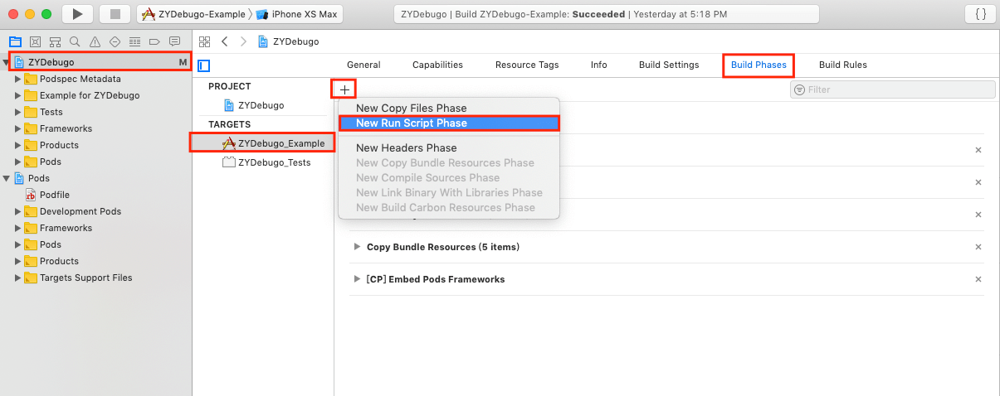
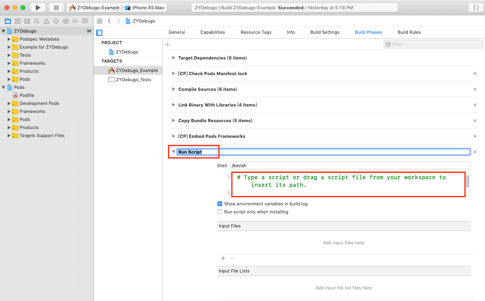

# 获取 Build 信息

如果你想实现以下功能：

* 获取安装包 build 时间
* 获取 build 安装包的电脑 hostname、UUID
* 获取当前代码的 git 分支以及最后一次 commit 信息
* 获取工程依赖的 CocoaPods 库
* 获取工程依赖的 Swift Package（`Package.resolved`）

那么你需要添加脚本到工程中，具体如下

1. 在 TARGETS 选中当前工程
2. 选中 Build Phases
3. 点击左上方 ✚ 号
4. 选中 New Run Script Phase

	
5. 建议将新建的 `Run Script` 更名为 `Debugo Build Info`

	
6. 展开这个选项，将 shell 脚本粘贴到输入框，保存即可

	```bash
	# 直接拖拽引入或者 CocoaPods 没有使用 use_frameworks!
	buildInfoSh="${BUILT_PRODUCTS_DIR}/${EXECUTABLE_FOLDER_PATH}/Debugo.bundle/com.ripperhe.debugo.build.info.sh"
	# CocoaPods use_frameworks!
	buildInfoSh2="${BUILT_PRODUCTS_DIR}/${EXECUTABLE_FOLDER_PATH}/Frameworks/Debugo.framework/Debugo.bundle/com.ripperhe.debugo.build.info.sh"
	
	if [ -x "${buildInfoSh}" ]; then
	${buildInfoSh}
	echo "com.ripperhe.debugo.build.info.sh path: ${buildInfoSh}"
	elif [ -x "${buildInfoSh2}" ]; then
	${buildInfoSh2}
	echo "com.ripperhe.debugo.build.info.sh path: ${buildInfoSh2}"
	else
	echo "com.ripperhe.debugo.build.info.sh not found!!! "
	fi
	```

⚠️ 上面这段脚本的其实就是从 bundle 中获取实际起作用的脚本进行执行。因为是从 budle 中获取脚本进行执行，所以第一次 build 的时候获取不到脚本，从第二次开始正常，个人认为不影响操作，不过需要知道这个点。

如果使用脚本1的时候，build 信息中总是提示 `com.ripperhe.debugo.build.info.sh not found!!! `，可能是因为什么未知的原因没有找到脚本。

[跳转到实际起作用的脚本文件链接 🚀](https://github.com/ripperhe/Debugo/blob/master/Debugo/Assets/Debugo.bundle/com.ripperhe.debugo.build.info.sh)

## Swift Package Manager

脚本会在编译时查找并拷贝 `Package.resolved` 到 App Bundle（文件名 `com.ripperhe.debugo.spm.package.resolved`），查找顺序大致为：

1. `SRCROOT` / `PROJECT_DIR` / 当前目录下的 `Package.resolved`
2. 同级目录中 `*.xcworkspace/xcshareddata/swiftpm/Package.resolved`（例如 `YourApp.xcworkspace/...`）
3. `*.xcodeproj/project.xcworkspace/xcshareddata/swiftpm/Package.resolved`

Debugo 的 **Swift Package Manager** 插件会解析该文件，列出 identity / 当前版本；对 `github.com` 仓库会额外请求 GitHub Releases/Tags 展示最新版本（未认证接口有速率限制，失败时最新版本留空）。
